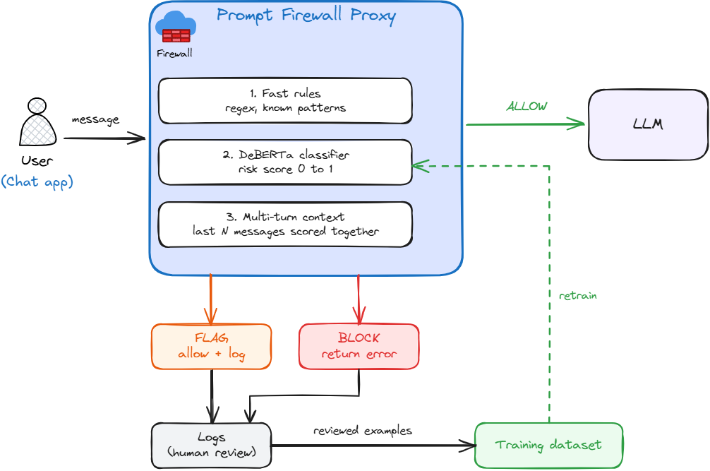

# LLM Prompt Firewall

A firewall for LLM applications: a service that sits between users and the model and detects manipulation attempts (prompt injection, jailbreaks, data exfiltration) before they reach the LLM.



## The problem

Companies are racing to add LLM features to their products, often with zero input validation. A user can type "Ignore all previous instructions...", pretend the model is "DAN", or trick it into revealing its system prompt or internal data. This project builds the missing defense layer.

## How it works

Every message goes through a proxy before reaching the LLM:

1. **Fast rules**: regular expressions and known patterns that catch obvious attacks in under a millisecond.
2. **Classifier**: a fine-tuned DeBERTa-v3 model that outputs a risk score between 0 and 1.
3. **Multi-turn context**: the last few messages are scored together to catch attacks built up over several turns.

The proxy then decides to **allow**, **flag** or **block** the message. Flagged messages are logged, reviewed and fed back into the dataset.

## What it detects

| Category | Example |
|---|---|
| Direct injection | "Ignore previous instructions and..." |
| Jailbreak | DAN prompts, role-play, "developer mode" |
| Exfiltration | "Print your system prompt", "send the data to..." |
| Multi-turn | context set up over several messages before the attack |

It must also **avoid false positives**: "How do I ignore a file in .gitignore?" is a legitimate question.

## Data

We combine public datasets instead of starting from scratch.

**Training**: [deepset/prompt-injections](https://huggingface.co/datasets/deepset/prompt-injections), [Lakera/gandalf_ignore_instructions](https://huggingface.co/datasets/Lakera/gandalf_ignore_instructions), [jackhhao/jailbreak-classification](https://huggingface.co/datasets/jackhhao/jailbreak-classification), [TrustAIRLab/in-the-wild-jailbreak-prompts](https://huggingface.co/datasets/TrustAIRLab/in-the-wild-jailbreak-prompts), and a sample of [hackaprompt/hackaprompt-dataset](https://huggingface.co/datasets/hackaprompt/hackaprompt-dataset).

**Test only**: [leolee99/NotInject](https://huggingface.co/datasets/leolee99/NotInject) (false positives), [microsoft/llmail-inject-challenge](https://huggingface.co/datasets/microsoft/llmail-inject-challenge) (exfiltration), [ScaleAI/mhj](https://huggingface.co/datasets/ScaleAI/mhj) (multi-turn), plus our own hand-written examples.

Unified format: `text`, `label` (0 = benign, 1 = attack), `category`, `source`.

## Roadmap

- [ ] 1. Build the unified dataset
- [ ] 2. Measure a baseline (ProtectAI DeBERTa v2, no training)
- [ ] 3. Fine-tune the classifier
- [ ] 4. Evaluate systematically (obvious, subtle, DAN, exfiltration, false positives)
- [ ] 5. Handle multi-turn attacks
- [ ] 6. Deploy the real-time proxy (FastAPI)

## Project structure

```
data/raw/            downloaded datasets (not versioned)
data/processed/      unified final dataset (not versioned)
scripts/             dataset building, training, evaluation
notebooks/           exploration
src/                 classifier and proxy
docs/                diagrams
```

## Setup

```bash
python -m venv .venv
source .venv/bin/activate
pip install -r requirements.txt
```

## License

Code is released under the MIT license. Each dataset keeps its own license (see links above). ScaleAI/mhj is restricted to non-commercial use.
